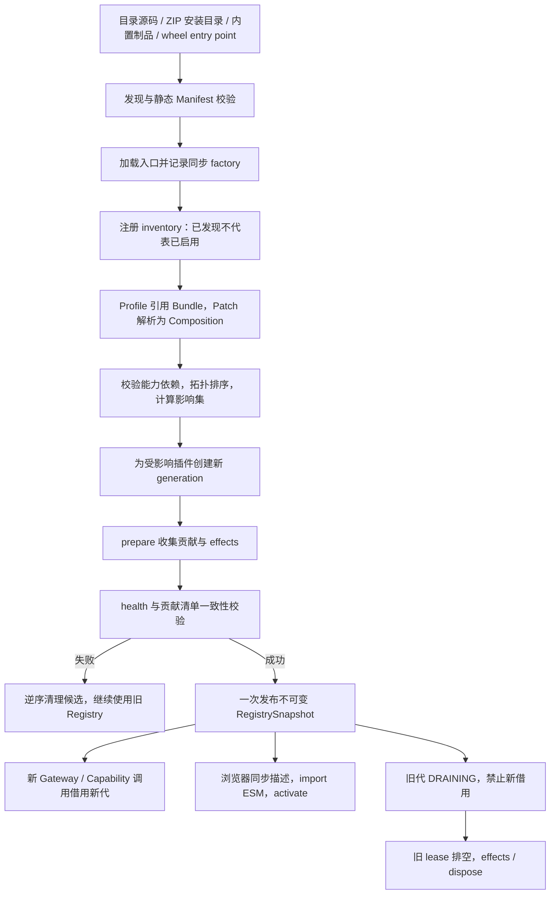
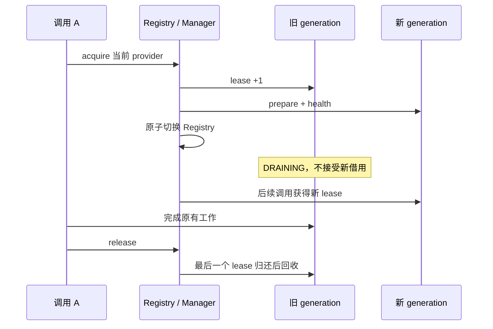

# 插件加载原理

以当前实现为准。理解本页后，应能回答：文件放哪里、什么时候 import、为什么启用会失败、更新时旧请求去哪、前端为什么需要 generation、资源何时回收。

## 1. 总体流程



这是源码阅读的逻辑主线；不是把 import、安装事务、浏览器激活都包成一个跨进程数据库事务。后端和客户端分别有自己的候选发布步骤。

## 2. 从哪里发现

| 来源 | 实际行为 |
| --- | --- |
| 源码运行 | 扫描仓库根 `plugins/`，再合并 `MANAGED_CONFIG_DIR/plugins`；同 ID 的受管目录覆盖源码目录 |
| 冻结桌面版 | 扫描受管插件目录，加载发行包 `builtin_plugin_files` 中允许内置 ID |
| ZIP 导入 | 安装器解压、检查后写到受管插件目录，交给同一运行时注册/激活 |
| wheel | 查询 `importlib.metadata` 的 `more_rag.plugins` entry point；适合普通 Python 部署 |
| 本开发中心 demos | 不在默认扫描根，不会因为存在 demo 或安装 SDK 就自动启用 |

受管目录由配置决定，开发者应从设置页打开，不要把某台机器的绝对路径写死。

当前 `install_all()` 先目录、再冻结内置、再 entry point 发现；同 ID 已在 `_plugins` 时，后来的来源不会简单覆盖已有实例。源码受管覆盖逻辑发生在目录发现层。不要同时通过多种来源分发同一个 ID 来依赖顺序竞争。冻结版内置 ID 还会拒绝第三方 ZIP 覆盖。

扫描安装容器时，如果有 `.active-release`，它指向容器下 `.releases/<release>/` 的代码目录。容器用来保存安装状态，代码根是当前不可变版本；不要把二者混为一谈。

## 3. import 前后做了什么

1. 读取 `plugin.toml`，校验 ID、SemVer、Python entrypoint、Host API、client API/路径、声明格式。
2. 计算内容 digest：遍历制品文件，排除 `__pycache__`、`.releases`、活动版本指针和根配置文件等；node_modules 目前没有通用排除规则，所以不要放进扫描目录。
3. 归档客户端 dist，检查 entry / CSS 等文件。加载 Python 入口时确认解析路径在制品内部。
4. 若有 vendor，将其追加到 `sys.path`；宿主依赖优先，不执行 .pth，不提供同进程依赖版本隔离。
5. 进程内目录插件使用 importlib 以生成模块名执行入口，找到 `file.py:object`。新插件的 object 是同步 factory，调用后必须得到 ID 一致的实例，并保留 factory 供后续换代。
6. 将插件登记到 manager，初始不意味着 ACTIVE。真正启用依赖持久化开关或活动 Profile。

**目录 Manifest 解析不执行 Python；发现流程后续可能 import 并调用 factory。** SDK `validate` 只做静态检查，和 Host 的发现流程不是同一件事。组合级缺失依赖、循环和冲突的关键检查发生在激活阶段，不应承诺所有 `requires` 在任何 import 之前都验证完毕。

process 模式此时记录 Host 侧隔离适配工厂，目标插件代码在后续启动子进程时加载；并不是发现就启动进程。wheel 则调用 entry point 自己的 load，不走目录 Manifest 的全部能力。

## 4. Profile、Bundle、Row 决定启用组合

Bundle 是一组完整 Row；每个 Row 指定插件、版本、启用状态、isolation、config。Profile 引用多个 Bundle，可用 Patch 替换、删除或在指定 Row 前后插入完整 Row。解析生成 Composition，包含 digest、revision 和来源信息。

同一组合当前不能启用同 ID 的多个实例。Row 的 isolation 必须与 Manifest 一致。没有 active Profile 时，设置页兼容开关也会走组合 reconcile；有 active Profile 时，兼容开关不能偷偷修改它。

激活时对当前启用清单进行 Capability 拓扑排序，宿主服务作为已有 provider。缺失强依赖、依赖环和冲突都拒绝候选。可选依赖若存在也参与依赖关系和换代影响集。

版本、配置、realm、制品 digest 或活动状态变化会影响插件；Provider 变化会继续影响消费者。普通 reconcile 尽量复用未受影响代，显式 reload 则强制重建活动组合。

## 5. 候选如何变为 ACTIVE

每个受影响插件调用 factory 得到新实例，并分配新的 generation ID。generation 不是插件版本号，Host 重启后也不会简单从 1 复用；浏览器应按不透明字符串处理，避免 JavaScript 安全整数截断。

候选状态从 `PREPARING` 到 `HEALTH_CHECKING`：

- Context 指向候选组合的 provider 集和当前 Row.config，不直接指向随时变化的全局 provider。
- `prepare(context)` 收集 provide/web/assets/ui/events，建立资源并登记 effects。
- `health()` 返回 False 或 hook 抛异常/超时，候选失败。当前 prepare/health hook 超时为 30 秒，不应用它包住无限运行的任务。
- 检查 actual provides 与 Manifest 完全相等，检查路由、UI ID 等冲突。
- 准备全部成功后，在锁内一次替换 `RegistrySnapshot`，更新 Composition，候选变 ACTIVE 并接受新 lease。

失败路径逆序释放已经准备的候选，旧 Registry 继续服务。这个机制只管理运行时贡献和已登记资源，**不自动回滚 prepare 中已经写入数据库、文件或外部服务的业务副作用**。因此候选准备应尽量无业务写入，后台消费等待 `context.is_active`。

## 6. lease 怎样保护旧请求



Web Gateway 按 `(plugin_id, method, path)` 精确查表，执行 handler 期间持有 lease。`item/{id}` 只是字面路径，不会获得 FastAPI 的模板参数匹配；用 query/body 或单个 dispatch。

客户端请求携带 `X-Plugin-Generation`，若当前绑定代不符，返回 409；插件停用、无活动代或没有对应路由一般返回 503。非法 generation 返回 422。没有 generation header 的普通 HTTP 请求使用当前代。

Capability 消费者应通过运行时借用作用域使用 provider，不跨独立工作单元缓存裸对象。插件 prepare 中解析的依赖属于其候选组合；Host 通过消费者换代保持依赖关系一致。

Gateway 的 lease 覆盖 handler 求值，不应由此推断任意 StreamingResponse 在网络上发送完前都会自动持有同一 lease。专用模型/Runtime 流有自己的借用契约；自定义长流需单独核对生命周期。

切换之后旧代进入 DRAINING，通知可选 drain 停止投递。最后一个 lease 释放时触发 effects 回收并标记 DISPOSED。关闭/停用路径还有等待和超时处理，因此插件仍需正确响应取消，不能把未结束的业务 run 在进程退出时误标成功。

## 7. 浏览器如何加载 ESM

1. Host 发布当前客户端 Registry 描述，包括 ID、version、字符串 generationId、artifactDigest、entryUrl、cssUrls、slots、commands 和客户端依赖。
2. ClientRuntime 比较当前实例与描述，按客户端依赖准备候选；未变化的实例可以保留。
3. 读取 CSS，`import(entryUrl)`，要求 default export 具有 activate 方法。
4. 创建带 scope/api/ui/commands/services/events/recovery 的 Context，调用 activate。注册时校验 contribution ID、Manifest slots 和 commands 等。
5. 候选成功后发布贡献、替换旧实例；失败清理候选，保留可恢复状态和旧客户端贡献。后端可能已经换代，旧客户端请求可遇到 409，这不意味着两端拥有分布式原子切换。
6. 卸载时 scope abort，运行清理、移除贡献。组件自己的 effect 也应清理监听和请求。

React / React DOM / SDK 由 Host import map 共享。一个插件不能携带独立 React 去挂入宿主组件树。客户端 services 是浏览器同页协作，不是 Python Capability Registry，也没有自动跨语言对象桥接。

| 资源 | 地址形状 | 保留行为 |
| --- | --- | --- |
| 普通贡献 asset | `/api/plugins/{id}/assets/{generation}/{path}` | 当前代可读；替换时有有界历史缓存，但依赖当前资源键等条件，不保证停用后仍可用 |
| React dist artifact | `/api/plugins/{id}/client/{digest}/dist/client.js` | 归档整个 dist，与活动 backend generation 解耦；内存中每插件最多 3 个 digest，重启/淘汰后旧地址可失效 |

不能把有界缓存宣传为永久回滚仓库。相同 JS digest 在后端配置变化时可能对应新的 generation，所以不能只看 JS URL 判断插件是否需换代。

## 8. process 模式如何转发

Host 侧 IsolatedDirectoryPlugin 在 prepare 期间由 Supervisor 启动：

```text
sys.executable -m app.platform.plugins.host --plugin-root ... --plugin-id ...
```

子进程读取入口、同步工厂，获取 capabilities/web/assets/ui 映射，不调用新式 prepare。握手校验协议版本、plugin ID/version/digest，健康检查通过后用 RemoteCapability 和 Web 代理登记到主 Registry。回收时 drain/shutdown，必要时 terminate/kill。

协议为 v1 JSON 行，request_id 匹配响应，单进程请求锁串行处理；双向帧上限 1 MiB，默认等待 3 秒。支持 JSON 服务调用和受限文本 Web/asset/UI，不支持 requires、完整 Request、流、二进制、通用 ASGI 或双向事件。只转发少量 headers，不透传 query/Cookie/Authorization。

stdout 必须只输出协议，当前 stderr 丢弃。子进程沿用宿主解释器，没有自动独立 venv，也不是 OS 沙箱。源码 Python launcher 可用不代表 Nuitka 冻结可执行文件能直接 `-m`，桌面版需要单独验证。

## 9. ZIP 安装、更新和卸载

安装器接受 ZIP 根或单层目录包，限制 50 MiB 压缩、100 MiB 解压、1000 文件，拒绝越界和宿主保留的版本目录/指针，并校验 Manifest、入口等。安装不执行 pip/npm。

首次安装写受管容器，同 ID 更新写 `.releases/<id>`，以 `.active-release` 指向有效代码。候选激活失败时撤销本次更新并恢复旧指针/工厂；已停用插件更新后也可以继续停用。内置 ID 不接受第三方覆盖。

受控 watcher 对比 digest，或管理接口显式检查变更。卸载先撤下当前组合、drain，再备份插件文件，业务数据保留。

保留旧版本文件不会自动隔离 Python `sys.modules`、延迟 import、全局单例和原生扩展。目录加载器会清理插件已导入模块以支持开发重载，vendor 则通常保留。复杂插件需要独立命名空间或合适的进程设计，不能假定任意多文件 Python 包都可无限安全并行换代。

## 10. 源码导航

以下是 Host 源码路径，公开资料包只带 SDK，不含这些 Host 文件。

| 问题 | 文件 / 关键入口 |
| --- | --- |
| 何时装配与启用 | `app/bootstrap/application.py`、`app/bootstrap/lifespan.py` |
| 目录来源、digest、import | `app/platform/plugins/directory.py`：discover_plugin_manifests / load_directory_plugin |
| 静态字段和拓扑排序 | `sdk/python/src/more_brain_plugin_sdk/manifest.py` |
| 发现、开关、重载、watcher | `app/platform/plugins/extensions.py`：install_all / activate_composition / watch_directory_plugins |
| Bundle / Profile / Patch | `app/platform/plugins/runtime/composition.py` |
| prepare、health、快照、lease、drain | `app/platform/plugins/runtime/manager.py`：activate_composition / acquire_web_handler / release |
| 注册表结构 | `app/platform/plugins/runtime/registry.py` |
| 逆序清理 | `sdk/python/src/more_brain_plugin_sdk/effects.py` |
| 固定 Gateway 与 MCP | `app/platform/plugins/runtime/gateway.py`、`mcp_gateway.py` |
| 客户端 dist 归档 | `app/platform/plugins/runtime/client_assets.py` |
| 子进程 | `app/platform/plugins/runtime/supervisor.py`、`isolated.py`、`app/platform/plugins/host.py` |
| 安装/卸载事务 | `app/platform/plugins/install.py`、`uninstall.py` |
| 客户端候选加载与卸载 | `frontend/src/runtime/runtime.ts`、`scope.ts`、`transport.ts` |
| 浏览器 SDK | `frontend/packages/plugin-sdk/src/index.ts` |
